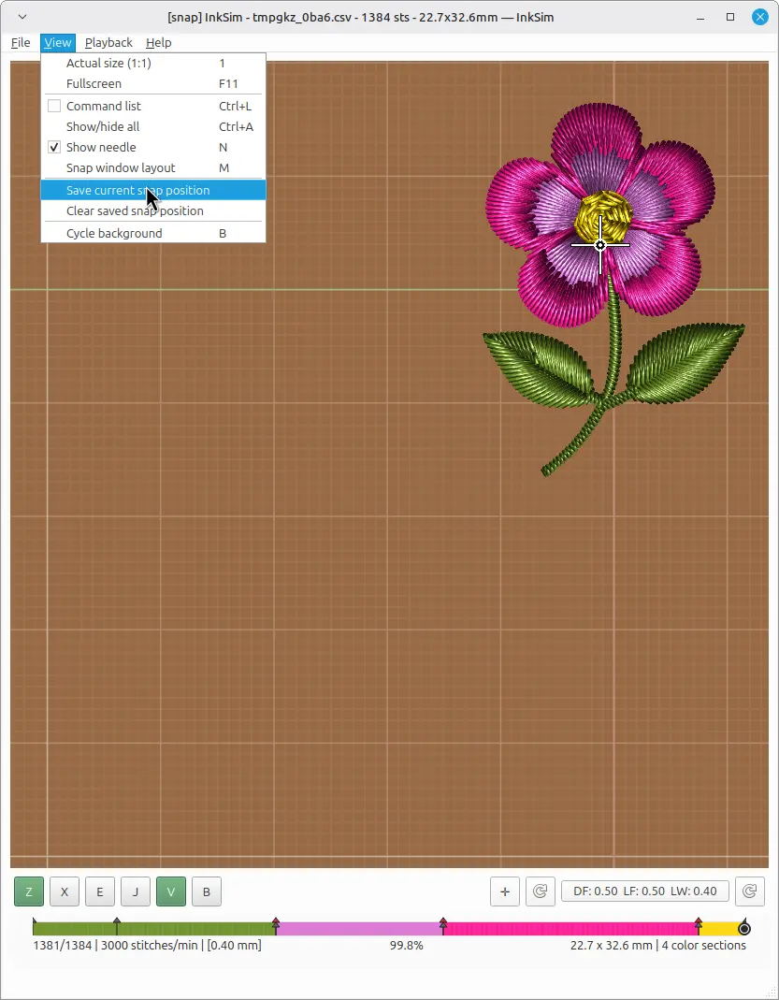

# Inkscape / Ink/Stitch / InkSim workflow

## Contents

- [Preview from Inkscape](#preview-from-inkscape)
- [Window layout and snap position](#window-layout-and-snap-position)
- [Export preview back to Inkscape](#export-preview-back-to-inkscape)
- [Tips](#tips)

## Preview from Inkscape

InkSim provides and installs its own Inkscape extension. Ink/Stitch is used by
that extension to export the document, but the Inkscape menu action itself is
shipped with InkSim. For first-time setup, launch InkSim and follow the
[installation guide](installation.md#inkscape-integration) to install the
extension, then restart Inkscape.

With an Inkscape document open, choose **Extensions → Inksim → Preview**. The
extension runs the installed Ink/Stitch exporter, then sends the generated
preview to InkSim through its own local IPC. InkSim starts its singleton
application if needed or reuses the running instance.

The extension does not define a shortcut by default. If available, **Ctrl+Shift+I**
is a convenient shortcut to assign to **Inksim → Preview** in Inkscape.

## Window layout and snap position

When you work with Inkscape on one side and InkSim on the other, use **View → Save current snap position** to remember the InkSim window position and size. The next time Ink/Stitch opens InkSim, the window snaps back to that layout.

You can also toggle the layout quickly with **View → Snap window layout** (**M**) or clear the saved position from the same menu.

## Export preview back to Inkscape

After inspecting the design, copy the rendered preview back to Inkscape:

1. Choose **File → Export shaded PNG for print**.
2. Click **Copy to clipboard**.
3. Switch to Inkscape and press **Ctrl+V** to paste the image next to your vector design.

The pasted image is the full-resolution preview, so it keeps the same quality as the saved PNG.

## Tips

- Press **R**, **X**, **J**, **N**, **G**, **E**, **Z**, etc. to switch renderers and overlays.
- The **bottom view** (**E**) shows how the back of the embroidery would look.
