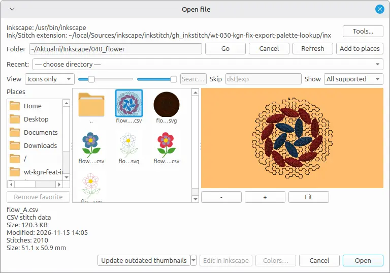
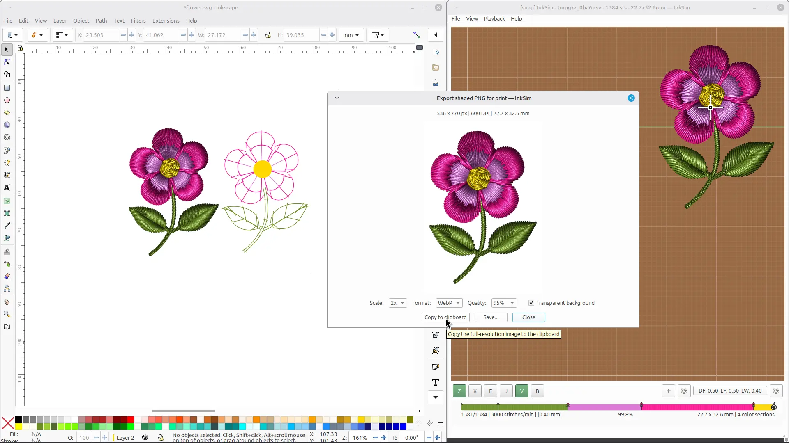

# Inkscape / Ink/Stitch / InkSim workflow

## Contents

- [Preview from InkSim](#preview-from-inksim)
- [Preview from Inkscape](#preview-from-inkscape)
- [Window layout and snap position](#window-layout-and-snap-position)
- [Export preview back to Inkscape](#export-preview-back-to-inkscape)
- [Tips](#tips)

## Preview from InkSim

The **Open file** dialog is part of InkSim. Open it with **File → Open...** or
press `Ctrl+O`. It can browse supported embroidery files, CSV stitch data, and
SVG source files. Selecting a file displays its preview and details; **Open**
loads the selected embroidery or CSV file into the main viewer.

### Navigate and find files

- Follow the clickable path breadcrumbs, or choose **Edit path**, enter or
  paste a folder path, and press **Go**.
- The back and forward buttons walk through the folders visited in this
  session; `Alt+Left` and `Alt+Right` do the same. The arrow up button, or
  `Alt+Up`, opens the parent folder.
- The **Places** panel provides common locations and drives. Use **Add to
  places** to save the current folder as a favorite; select a favorite and
  choose **Remove favorite** to remove it. The **Recent** menu returns to
  previously visited folders.
- Use the **Show** menu to display all supported files, embroidery files,
  SVG sources, or CSV stitch data. Search matches file names; folders remain
  visible so you can continue navigating. **Skip** hides extensions entered
  with `|` separators, such as `dst|exp`.
- **View** switches between **Icons & text**, **Icons only**, and **Details**.
  The sliders adjust icon size and the grid background shade. With the pointer
  over the file list, `Ctrl`+wheel changes icon size and `Shift`+wheel changes
  the background shade. View and appearance settings are remembered.
- Use the arrow keys to move through the list. Press `Enter` or double-click a
  folder to enter it, or a supported file to open it.

The status at the top reports the detected Inkscape executable and Ink/Stitch
extension. **Tools...** in the dialog opens InkSim's Inkscape setup, where you
can inspect or install its extension.

### Preview and open

Selecting an embroidery or CSV file loads a stitch preview. The details area
shows the file type, file size, modified time, stitch count, and design
dimensions when available. Use the preview's `−`, `+`, and **Fit** buttons,
the mouse wheel to zoom, or left-drag to pan.

Selecting an SVG shows a vector preview. Choose **Preview** to convert the
saved SVG to stitch data with Inkscape and Ink/Stitch, or **Edit in Inkscape**
to open the source in a new Inkscape window. If the required tool is missing,
the status and action hints explain what is unavailable. The SVG preview uses
the saved file on disk, not unsaved editor changes.

The **Colors...** action is available for embroidery or CSV files that do not
contain their own thread colors. It loads a palette from a palette file or
another design and saves it beside the current file as a matching `.edr`
sidecar.

### Thumbnails and file actions

Select one or more designs and use the thumbnail button to **Update outdated
thumbnails** or **Regenerate all thumbnails**. InkSim creates 256-pixel PNG
sidecars beside the designs and reports progress.

Right-click a selection for thumbnail rotation actions, followed by **Copy
files**, **Move files**, and **Paste files**. Rotation changes the thumbnail
PNG only, not the embroidery design. Copy and Move apply to files, not folders;
an associated palette sidecar and existing PNG thumbnail are included when
available. Before a transfer, InkSim checks the whole destination batch. One
confirmation lists all conflicts and lets you replace all or cancel without
transferring anything. A failed transfer is rolled back where possible.
Copy can be pasted repeatedly; a successful Move consumes the pending
operation. The pending operation is cleared when the dialog is opened again.

### Refresh the folder

The current folder refreshes automatically when filesystem changes are
detected and when the dialog regains focus. Use **Refresh** or `Ctrl+R` if a
change does not appear.

## Preview from Inkscape

InkSim also provides its own Inkscape extension. For first-time setup, launch
InkSim and follow the [installation guide](installation.md#inkscape-integration)
to install the extension, then restart Inkscape.

With an Inkscape document open, choose **Extensions → Inksim → Preview**. The
extension runs the installed Ink/Stitch exporter, then sends the generated
preview to InkSim. InkSim starts its singleton application if needed or
reuses the running instance.

The extension does not define a shortcut by default. If available, **Ctrl+Shift+I**
is a convenient shortcut to assign to **Inksim → Preview** in Inkscape.

## Window layout and snap position

When you work with Inkscape on one side and InkSim on the other, use **View → Save current snap position** to remember the InkSim window position and size. The next time InkSim opens a viewer window, it uses that layout.

You can also toggle the layout quickly with **View → Snap window layout** (**M**) or clear the saved position from the same menu.

## Export preview back to Inkscape

After inspecting the design, copy the rendered preview back to Inkscape:

1. Choose **File → Export → Shaded print...**.
2. Click **Copy to clipboard**.
3. Switch to Inkscape and press **Ctrl+V** to paste the image next to your vector design.

The pasted image is the full-resolution preview, so it keeps the same quality as the saved PNG.

## Tips

- Press **R**, **X**, **J**, **N**, **G**, **E**, **Z**, etc. to switch renderers and overlays.
- The **bottom view** (**E**) shows how the back of the embroidery would look.
