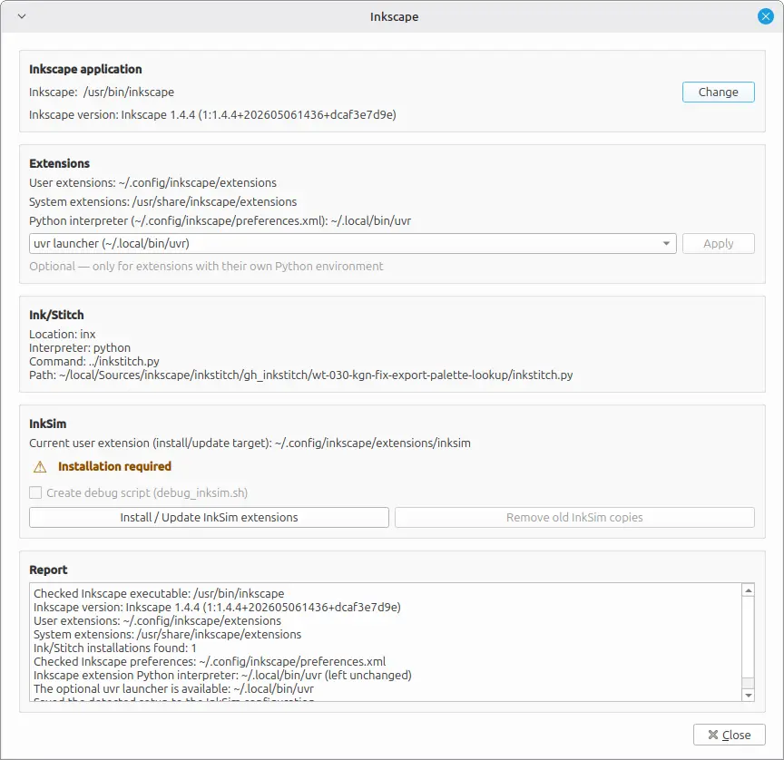

# Installation and Running

## Contents

- [Quick start](#quick-start)
- [Inkscape integration](#inkscape-integration)
- [Update](#update)
- [Alternative installers](#alternative-installers)
- [Developer install](#developer-install)
- [Command-line and GUI modes](#command-line-and-gui-modes)
- [Running options](#running-options)
- [GPU textured renderer](#gpu-textured-renderer)

InkSim is a **standalone GUI application** with an optional, bundled Inkscape
extension. The extension is shipped with InkSim; Ink/Stitch supplies the
embroidery exporter that it uses.

## Quick start

1. Install [`uv`](https://docs.astral.sh/uv/getting-started/installation/):
   - **macOS / Linux:**

     ```bash
     curl -LsSf https://astral.sh/uv/install.sh | sh
     ```

   - **Windows (PowerShell):**

     ```powershell
     powershell -ExecutionPolicy ByPass -c "irm https://astral.sh/uv/install.ps1 | iex"
     ```

   Restart the terminal so `uv` is on `PATH`.

2. Install InkSim:

   ```bash
   uv tool install inksim
   ```

3. Run it:

   ```bash
   inksim
   inksim design.pes
   ```

On Windows, `inksim-gui design.pes` starts without a console window.

## Inkscape integration

InkSim installs its own **Preview** extension into Inkscape's user extensions
folder. You need Inkscape and Ink/Stitch installed. The extension is installed
from the InkSim GUI, so launch InkSim at least once after installing it:

1. In InkSim, choose **Tools → Inkscape Setup...**.
2. Click **Install / Update InkSim extensions**.
3. Restart Inkscape so it loads the new extension.
4. Open a document in Inkscape and choose **Extensions → Inksim → Preview**.


<p align="center"></p>


The extension asks Ink/Stitch to export the current document, then forwards
the resulting preview to InkSim. Its launcher starts the singleton application
if needed, or reuses the running instance, and manages the handoff through
local IPC.

The extension does not assign a keyboard shortcut. If `Ctrl+Shift+I` is free
in your Inkscape setup, consider assigning it to **Inksim → Preview** in
Inkscape's keyboard-shortcut settings.

## Update

For an installation made with `uv`, update from PyPI with:

```bash
uv tool upgrade inksim
```

For a standard PyPI installation, this upgrades InkSim from PyPI. InkSim
release candidates are published through GitHub Releases, not PyPI; install a
candidate directly from its GitHub release page if you want to test one.

In the GUI, **Help → Check for updates** checks the newest stable version on
PyPI and reports whether an update is available; it does not install anything.
It also checks automatically once per day by default. Pre-releases are not
offered by this regular update check. Once the matching final release is
published on PyPI, the update check offers it. The automatic check can be
disabled with `update_check_enabled = false` and its interval changed with
`update_check_interval_days` in the InkSim configuration file.

## Alternative installers

`uv` is not required. Any of these work:

```bash
# pip + venv
python -m venv .venv
. .venv/bin/activate            # Windows: .venv\Scripts\Activate.ps1
python -m pip install inksim

# pipx
pipx install inksim

# Poetry
poetry add inksim

# Conda
conda create -n inksim python=3.11
conda activate inksim
pip install inksim
```

## Developer install

```bash
git clone https://github.com/oorteo/inksim.git
cd inksim
uv sync
uv run inksim design.pes
```

## Command-line and GUI modes

- `inksim` — console launcher; keeps output in the terminal.
- `inksim-gui` — GUI launcher.

Both commands exist on Windows, macOS, and Linux. On Linux and macOS they are
identical. Only on Windows do they differ: `inksim-gui` is a GUI-subsystem
executable (a legacy of Windows' DOS heritage) that starts without a console
window, while `inksim` opens one. Use `inksim-gui` on Windows for shortcuts,
file associations, and `Win+R`.

The installed extension uses the InkSim launcher selected during setup. On
Windows, use `inksim-gui` when you want the GUI launcher to run without a
console window.

## Running options

```bash
inksim design.pes --play
inksim design.pes --fullscreen
inksim design.pes --size 1600x1000 --position 100,50
inksim .                        # open the file dialog in this directory
```

## GPU textured renderer

The GPU renderer (`Z`) requires **OpenGL 3.3**. On systems without OpenGL 3.3 —
including virtual machines without 3D acceleration — InkSim falls back to the
CPU renderer automatically.
